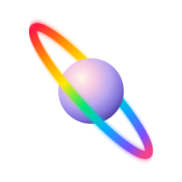

<table>
<tr>
<td colspan="2" align="center">
 
&nbsp;
&nbsp;

  
</td>
</tr>
<tr>
<td colspan="2">
<h3>&nbsp;Hey there! I'm Mayank 👋</h3>
</td>
</tr>
<tr>
<td width="68%" valign="top">

**AI builder & full-stack developer**

I like turning ideas into shipped products, fast: AI agents, computer vision, and polished web apps that real people can actually use.

Lately I've been building **Deforestation Monitor** (monthly forest-loss maps from Sentinel-2 with a U-Net), **Sanket** (AI emergency triage for multilingual calls) and **Sidekick** (a macOS AI buddy that lives in the notch). My playground: TypeScript, React / Next.js, Python, Swift, and LLMs wired into real workflows.

</td>
<td width="32%" align="center">

</td>
</tr>
</table>

### 🛠️ Toolbox

### 🚀 Things I've shipped

<table>
<tr>
<td width="50%" valign="top">

🌳 **[Deforestation Monitor](https://github.com/mayank-ydvv/deforestation-monitor)** · [live](https://deforestation-monitor-five.vercel.app) 
Monthly forest-loss maps from free Sentinel-2 imagery. U-Net segmentation + ONNX change detection.

</td>
<td width="50%" valign="top">

🚨 **[Sanket](https://github.com/mayank-ydvv/sanket)** 
AI emergency triage: multilingual calls and SMS become ranked, de-duplicated incidents on a live map.

</td>
</tr>
<tr>
<td valign="top">

🧠 **[Cortex](https://github.com/mayank-ydvv/cortex)** · [live](https://cortex-bice-three.vercel.app) 
A notebook that remembers your AI chats, with cited, date-aware answers.

</td>
<td valign="top">

🐝 **[BugSwarm](https://github.com/mayank-ydvv/bugswarm)** · [live](https://bugswarm.vercel.app) 
A swarm of automated testers that finds bugs and hands you ready-to-paste fix prompts.

</td>
</tr>
<tr>
<td valign="top">

🪄 **[Sidekick](https://github.com/mayank-ydvv/sidekick)** 
macOS AI buddy next to your cursor and in the notch: sees your screen, talks back, does tasks.

</td>
<td valign="top">

🏠 **[Saathi](https://github.com/mayank-ydvv/saathi)** 
Elder-care guardian on Ring, built as tech lead for the Amazon Developer Hackathon 2026.

</td>
</tr>
</table>

✨ Ideas → commits → products ✨

